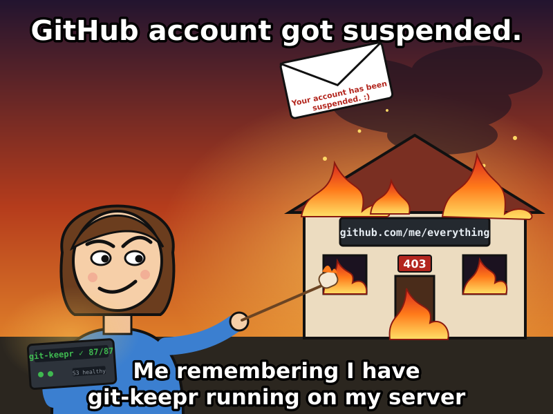

# git-keepr

**Your Git history. Your storage. Your control.**

You never know when access to a hosting account could disappear. An account can be
suspended, compromised, accidentally deleted, or temporarily unavailable. Your
repositories shouldn't exist in only one place.

**git-keepr** is a lightweight, self-hosted Git backup service written in Go. It
periodically mirrors your registered repositories with full reachable Git
history and keeps independent copies on local storage and optionally on S3-compatible
storage (including AWS S3, Cloudflare R2, and MinIO).

- **Full Git history:** branches, tags, commits and Git objects, not ZIPs of the latest files.
- **Read-only access:** a GitHub fine-grained PAT with `Contents: Read-only`.
- **Built-in scheduler:** no external cron or webhook.
- **Your choice of storage:** local bare Git mirrors, plus portable Git bundles in S3.
- **Small:** one Go process, no database, queue or web dashboard.
- **Offline restore:** recover from your last completed backup without GitHub.

> **Scope:** git-keepr backs up Git repository data reachable from fetched refs.
> It does not yet back up Git LFS payloads, issues, pull-request discussions,
> releases, repository settings, or submodule contents. Force-pushed-away commits
> may not be retained, and a current mirror is not an immutable historical archive.
> For stronger protection against malicious changes, enable object versioning or
> retention controls on your S3 bucket.

<p align="center">
  
</p>

git-keepr is an independent open-source project, not affiliated with GitHub.

## How it works

```text
GitHub --(fetch, read-only PAT)--> local bare mirror --(git bundle)--> S3 bucket
         every interval                                 only when refs changed
                                                        or S3 is out of date
```

Each repository is handled on its own. A failure on one doesn't block the others, and a
failed S3 upload never touches the local mirror.

## Requirements

- Linux with `git` (2.28 or newer) and CA certificates, on `amd64` or `arm64`. macOS binaries are published for development only, and the systemd installer is Linux-only.
- Go 1.25 or newer, only to build from source.
- S3 credentials are optional. Without them git-keepr keeps local mirrors only.
- Or Docker with the Compose plugin; the image already contains `git` and CA certificates.

## Quick start with Docker Compose

```bash
git clone https://github.com/<owner>/git-keepr.git && cd git-keepr   # use the real owner
cp config.example.yaml config.yaml
cp .env.example .env
# edit config.yaml (repositories, credentials, storage) and .env (PATs, S3 keys)
chmod 644 config.yaml      # no secrets in it; the container user (UID 10001) must be able to read it
chmod 600 .env             # secrets; only Docker Compose on the host reads it
docker compose up -d --build
docker compose logs -f
```

Other commands:

```bash
docker compose run --rm git-keepr sync --once --config /etc/git-keepr/config.yaml
docker compose run --rm git-keepr status --config /etc/git-keepr/config.yaml
docker compose run --rm git-keepr config validate --config /etc/git-keepr/config.yaml
```

Notes:

- Keep `storage.local.root: /data` in `config.yaml`; the named volume `git_keepr_data` is mounted there and survives `docker compose down`, rebuilds and upgrades. Don't run `docker compose down -v` unless you want the mirrors deleted.
- The container runs as UID/GID 10001 with a read-only root filesystem and `no-new-privileges`. No ports are published.
- On SELinux hosts (Fedora, RHEL), add `:z` to the config bind mount in `compose.yaml`: `./config.yaml:/etc/git-keepr/config.yaml:ro,z`.
- To keep data on a NAS instead of the named volume, make the directory writable by UID 10001 and bind-mount it:

  ```bash
  sudo mkdir -p /mnt/nas/git-keepr && sudo chown 10001:10001 /mnt/nas/git-keepr && sudo chmod 700 /mnt/nas/git-keepr
  ```

  ```yaml
      volumes:
        - ./config.yaml:/etc/git-keepr/config.yaml:ro
        - /mnt/nas/git-keepr:/data
  ```

  NFS or SMB shares that squash ownership, or don't support POSIX permissions and `flock`, may not work. Try `sync --once` first.
- Once a release has been published, a prebuilt image is available at `ghcr.io/<owner>/git-keepr:<version>`. Take the real owner and version from the Releases page. Until then, build locally as above.

## Creating the GitHub token

git-keepr only needs read access. Create one fine-grained personal access token per resource owner:

1. GitHub, then Settings, Developer settings, Personal access tokens, Fine-grained tokens, Generate new token.
2. Resource owner: the user or organization that owns the repositories. A fine-grained token belongs to exactly one owner, so use a separate token per owner and give each its own entry under `credentials:`.
3. Repository access: "Only select repositories", and pick just the ones in your `config.yaml`.
4. Repository permissions: set Contents to Read-only. GitHub adds Metadata (read-only) automatically. Don't grant write permissions and don't use a classic token with the `repo` scope.
5. Expiration: choose a date you'll remember. When a token expires, every sync of its repositories fails with 401 or 403. Generate a new one, update the environment variable (`.env` or `/etc/git-keepr/credentials.env`) and restart.
6. Some organizations require an owner to approve fine-grained tokens, or block them. Until approved, the token fails with 403 or 404.

## Native Linux install (systemd)

```bash
# 1. get a binary: build it...
make dist                                  # dist/git-keepr-linux-amd64 and -arm64
# ...or download a release archive from the Releases page and extract it

# 2. config with /var/lib/git-keepr as the data root
cp config.example.yaml config.yaml
sed -i 's#root: /data#root: /var/lib/git-keepr#' config.yaml
$EDITOR config.yaml

# 3. install (safe to re-run to upgrade)
sudo ./scripts/install.sh --binary ./dist/git-keepr-linux-amd64 --config ./config.yaml
# or, with Go installed: sudo ./scripts/install.sh --build --config ./config.yaml
```

The installer creates:

- a `git-keepr` system account with no login shell,
- `/etc/git-keepr` (config, mode 0750) and `/var/lib/git-keepr` (data, mode 0700),
- `/etc/git-keepr/credentials.env` (root-owned, mode 0600) for secrets,
- the unit `/etc/systemd/system/git-keepr.service`.

It starts the service only if `config validate` passes. Otherwise it leaves everything installed and prints what to do next. Re-running it doesn't overwrite your config or credentials and doesn't delete data. `--no-start` installs without starting, and `--uninstall` removes only the unit and binary.

Put your tokens in `/etc/git-keepr/credentials.env` (`KEY=value` lines, like `.env.example`), then:

```bash
sudo systemctl enable --now git-keepr
sudo systemctl status git-keepr
sudo journalctl -u git-keepr -f
sudo systemctl restart git-keepr
```

systemd reads the `EnvironmentFile`, and its values become environment variables of the service process only. Keep it `root:root` with mode 0600.

## Configuration

`config.example.yaml` is the reference:

```yaml
version: 1

scheduler:
  default_interval: 6h
  max_concurrency: 2
  sync_on_start: true

credentials:
  personal:
    type: github_pat
    token_env: GITHUB_PAT_PERSONAL
  work:
    type: github_pat
    token_env: GITHUB_PAT_WORK

repositories:
  - id: github/example/backend
    url: https://github.com/example/backend.git
    credential: personal
    interval: 1h
  - id: github/example/frontend
    url: https://github.com/example/frontend.git
    credential: personal

storage:
  local:
    root: /data
  s3:
    enabled: true
    bucket: git-keepr-backups
    prefix: repositories/
    region: auto
    endpoint: https://ACCOUNT_ID.r2.cloudflarestorage.com   # omit for AWS S3
    path_style: true
```

| Field | Meaning |
|---|---|
| `version` | Must be `1`. Unknown fields are rejected, so typos get caught. |
| `scheduler.default_interval` | Time between syncs of a repository (Go duration, minimum `1m`, default `6h`). |
| `scheduler.max_concurrency` | How many repositories can sync at once (default `2`). |
| `scheduler.sync_on_start` | Sync every repository as soon as `serve` starts (default `true`). |
| `credentials.<name>.type` | `github_pat`, the only type for now. |
| `credentials.<name>.token_env` | Name of the environment variable that holds the PAT. Never put a token in the YAML. |
| `repositories[].id` | `github/<owner>/<repo>`. Also used as the on-disk and S3 path, so `..`, absolute paths and backslashes are rejected, as are duplicates that differ only in case. |
| `repositories[].url` | `https://github.com/<owner>/<repo>[.git]`, with no user info, port, query or fragment. |
| `repositories[].credential` | A name from `credentials:`. One credential per resource owner. |
| `repositories[].interval` | Overrides `default_interval` for this repository. |
| `storage.local.root` | Absolute directory for mirrors, state, staging and locks. |
| `storage.s3.enabled` | `false` or omitted keeps everything local, and AWS credentials aren't needed. |
| `storage.s3.bucket`, `prefix` | Destination. Objects are stored as `<prefix><id>/latest.bundle`. |
| `storage.s3.region` | A real region for AWS (`eu-west-1`), `auto` for Cloudflare R2, anything for MinIO (`us-east-1`). |
| `storage.s3.endpoint` | Leave out for AWS S3. For R2 or MinIO, set an HTTPS URL such as `https://<account>.r2.cloudflarestorage.com`. |
| `storage.s3.path_style` | `true` for MinIO and R2, `false` or omitted for AWS S3. |

S3 credentials don't go in the config. git-keepr uses the AWS SDK default chain, normally `AWS_ACCESS_KEY_ID`, `AWS_SECRET_ACCESS_KEY` and optionally `AWS_SESSION_TOKEN` from `.env` or `credentials.env`. Plain-HTTP endpoints are rejected, so put MinIO behind TLS.

Environment variables: `GIT_KEEPR_CONFIG` (default config path), `GIT_KEEPR_LOG_FORMAT` (`text` or `json`), `GIT_KEEPR_LOG_LEVEL` (`debug`, `info`, `warn`, `error`).

## Commands

```text
git-keepr serve --config /etc/git-keepr/config.yaml
git-keepr sync --once --config ./config.yaml
git-keepr sync --once --repo github/owner/backend --config ./config.yaml
git-keepr status --config ./config.yaml
git-keepr restore --repo github/owner/backend --from local --output ./restored.git --config ./config.yaml
git-keepr restore --repo github/owner/backend --from s3    --output ./restored.git --config ./config.yaml
git-keepr config validate --config ./config.yaml
git-keepr version
```

- `serve` checks the config and tokens, syncs everything right away (unless `sync_on_start: false`), then repeats each repository at its own interval. A failing repository is logged and retried next interval; the daemon keeps running. On SIGINT or SIGTERM it stops running `git` processes, lets in-flight work finish and exits 0. An interrupted first clone leaves no partial mirror.
- `sync --once` syncs once and prints a table with one row per repository. It exits non-zero if any selected repository failed a required destination (the local mirror, and S3 when enabled), or was skipped because another sync of that repository was already running. The lock is shared with `serve`.
- `status` shows, for each repository, the last successful fetch, the last successful S3 publish, the stored refs digest, ref counts, durations and the last errors. It reads local state files only, and exits 1 if any destination has a recorded error.
- `restore` creates a new bare repository at `--output`. It won't overwrite an existing path. It verifies the bundle's SHA-256 (S3 only), checks the restored refs and runs `git fsck`. It needs no GitHub access and no PAT.
- `config validate` checks URLs, duplicate ids, unknown credentials, durations, that the token variables are set (names only, never values), that local storage is writable, and the S3 settings and credentials. It doesn't sync anything or contact GitHub or your bucket.

Exit codes: 0 success, 1 runtime failure, 2 usage error, 3 invalid configuration or missing credentials.

## Data layout and behavior

```text
/data/
  mirrors/github/example/backend.git/   full bare Git mirror
  state/github/example/backend.json     last Git and S3 results, SHA-256, times
  staging/                              temporary bundle files
  locks/                                per-repository lock files

s3://git-keepr-backups/repositories/github/example/backend/latest.bundle
```

### Full history, not snapshots

The mirror, and the bundle made from it, hold the full history reachable through the refs fetched at sync time: every branch and tag, the objects they reach, and any other refs GitHub shows your token (such as `refs/pull/*`). S3 holds only the current bundle. There is no snapshot schedule, retention policy or snapshot browser.

Fetching uses `--no-prune`, so branches deleted upstream stay in the mirror. That makes it a preservation-friendly copy, not an exact mirror of the source.

### What isn't guaranteed

Commits that become unreachable after a force-push may be lost. The local mirror never prunes (`gc.pruneExpire=never`), but the S3 bundle only contains reachable commits and gets overwritten. Commits deleted before the first backup can't be recovered. Git LFS payloads aren't backed up; only the pointer files in history are.

### When it uploads

git-keepr fingerprints the local refs (sorted ref names, object ids and the HEAD target) and compares that with the fingerprint of the last bundle it published successfully. File modification times play no part. When they differ, it builds a bundle with `git bundle create --all`, runs `git bundle verify`, hashes it, uploads it with the SHA-256 stored as object metadata, then reads it back with a HEAD request to confirm size and checksum before recording success. If nothing changed and the S3 object still matches the recorded size and checksum, nothing is uploaded.

### Failures and retries

- Git and S3 results are recorded separately. A successful fetch never marks S3 as up to date.
- If S3 fails, the local mirror and the last completed S3 object are left alone. The next cycle retries the upload even if the upstream refs haven't changed, and without cloning again. This survives restarts because it lives in `state/*.json`.
- If GitHub is unreachable or a token has expired, the error is recorded, the mirror is kept, and any pending S3 upload still goes ahead from the local mirror.
- Only one process syncs a given repository at a time. A second attempt is skipped and reported.
- State files are written atomically, temporary files are cleaned up, and a completed mirror is never deleted.

### Empty repositories

A repository with no commits can't be bundled. git-keepr mirrors it locally, records the status `empty`, uploads nothing, and says that S3 backup starts after the first commit. This isn't treated as an error.

### Default branch

The mirror's `HEAD` follows the source's default branch, including renames. A change of default branch triggers a new bundle.

## Restore

Restores produce a bare repository. Test one before you need it, ideally with the network off.

From the local mirror:

```bash
git-keepr restore --repo github/example/backend --from local --output ./restored.git --config ./config.yaml
```

From the S3 bundle:

```bash
git-keepr restore --repo github/example/backend --from s3 --output ./restored.git --config ./config.yaml
```

The S3 restore downloads `latest.bundle`, checks its SHA-256 against the value recorded at upload, restores it, verifies the refs and runs `git fsck`. It needs only `AWS_ACCESS_KEY_ID` and `AWS_SECRET_ACCESS_KEY`.

Check the result:

```bash
git --git-dir=restored.git fsck
git --git-dir=restored.git for-each-ref | head
git clone ./restored.git checkout-test && git -C checkout-test log --oneline | head
```

### Without git-keepr

The artifacts are plain Git. With only `git` and an S3 client:

```bash
aws s3 cp s3://git-keepr-backups/repositories/github/example/backend/latest.bundle ./latest.bundle \
  --endpoint-url https://ACCOUNT_ID.r2.cloudflarestorage.com      # omit for AWS S3
# optional: compare with the checksum recorded at upload time
sha256sum latest.bundle
aws s3api head-object --bucket git-keepr-backups --key repositories/github/example/backend/latest.bundle \
  --endpoint-url https://ACCOUNT_ID.r2.cloudflarestorage.com --query Metadata.sha256
git clone --mirror ./latest.bundle restored.git      # git verifies the bundle while cloning
git -C restored.git remote remove origin             # otherwise it points at the bundle file
git -C restored.git fsck
```

A directory under `mirrors/` is already a bare repository, so `git clone --mirror /var/lib/git-keepr/mirrors/github/example/backend.git restored.git` also works (then remove the `origin` remote the same way).

### Moving to another host

```bash
git -C restored.git push https://new-host.example/owner/backend.git 'refs/heads/*' 'refs/tags/*'
```

Push branches and tags explicitly. Other servers usually reject GitHub's `refs/pull/*`.

## Security notes

- **Tokens.** PATs are read only from environment variables. They never end up in YAML, Git remote URLs, `.git/config`, state files, S3 keys or metadata, bundles, logs or command-line arguments. For each Git command, the selected token goes to a short-lived `git` process through its environment and an askpass helper (the git-keepr binary itself, with the username `x-access-token`). Credential helpers and interactive prompts are disabled, and the child's environment is built from scratch so other tokens and S3 keys aren't inherited. Error output is scrubbed before it's logged or stored. While a Git command runs, the token is readable by the same Unix user through `/proc/<pid>/environ`.
- **Least privilege.** Use fine-grained PATs with `Contents: Read-only` on only the repositories you need. git-keepr never pushes to GitHub.
- **S3 permissions.** The key needs `s3:PutObject`, `s3:AbortMultipartUpload`, `s3:GetObject` (also used for the HEAD check) and `s3:ListBucket` on the bucket and prefix, and no delete permissions. Without `ListBucket`, S3 returns 403 instead of 404 for a missing object, so git-keepr can't tell "missing" from "forbidden" and republishes. Add a lifecycle rule that aborts incomplete multipart uploads.
- **Overwritten backups.** A key that can overwrite `latest.bundle` can also replace it with something bad. Turn on bucket versioning and, where available, Object Lock with a retention period. git-keepr doesn't enable either, and it doesn't claim immutable or ransomware-proof backups.
- **Encryption at rest.** git-keepr stores source code unencrypted. Use disk or volume encryption locally and server-side encryption on the bucket (R2 encrypts by default).
- **Local permissions.** The service runs with umask 077, so directories are 0700 and state files 0600. Run it as a dedicated non-root account, which the installer and the Docker image both do.
- **Docker secrets.** Keep `.env` out of Git (it's in `.gitignore` and `.dockerignore`) with mode 0600, and never put tokens in images or build arguments.
- **Transport.** Only HTTPS is accepted, for GitHub and for the S3 endpoint, and Git itself is restricted to the `https` protocol.

## What is not backed up

- Git LFS objects (only the pointer files in history)
- Issues, pull-request descriptions and comments
- Releases and release assets
- Wikis
- GitHub Actions artifacts and settings
- Repository settings and permissions
- Submodule contents: the references are in history, but the repositories they point to aren't backed up unless you register them too
- Commits deleted from GitHub before the first backup
- Commits removed by a force-push (not guaranteed)

## Troubleshooting

| Symptom | Likely cause and fix |
|---|---|
| `401`, `403` or `Authentication failed` | The PAT expired, was revoked, lacks `Contents: Read-only`, belongs to a different owner than the repository, or is waiting for organization approval. Fix the token, update the environment file and restart. |
| `404` or `Repository not found` | For private repositories GitHub answers 404 when the token can't see the repo. Check the URL, and that the token's owner and selected repositories include it. |
| `permission denied` on `/data` or a bind mount | The data directory must be writable by the service user: UID 10001 in Docker (`sudo chown 10001:10001 <dir>`), or `git-keepr` for systemd (`/var/lib/git-keepr`). |
| `open /etc/git-keepr/config.yaml: permission denied` (Docker) | Run `chmod 644 config.yaml` (it holds no secrets). On SELinux hosts also add `:z` to the mount. |
| R2: `SignatureDoesNotMatch` or `InvalidRegion` | Use `region: auto`, an HTTPS endpoint like `https://<account-id>.r2.cloudflarestorage.com` and `path_style: true`. Check that the R2 API token has Object Read & Write on the bucket. |
| AWS S3 errors | Leave `endpoint` out, use the bucket's real region and set `path_style: false`. |
| `no AWS credentials were found` | Set `AWS_ACCESS_KEY_ID` and `AWS_SECRET_ACCESS_KEY` in the service environment (see `.env.example`), or set `storage.s3.enabled: false`. |
| `s3_status=empty` | The repository has no commits yet. The local mirror exists, and S3 backup starts after the first commit. |
| `s3_status=error` on every run | Run `git-keepr status` for the message. The previous S3 object is untouched and the upload is retried each cycle. |
| Timeouts or an unreachable source | Network or GitHub outage. The mirror is kept and syncing resumes by itself. Behind a proxy, set `HTTPS_PROXY`; it's passed to both Git and S3. |
| `another sync of this repository is already running` | A `serve` daemon or another `sync --once` holds the lock. Wait, or rely on the daemon. |
| Fetch keeps failing with `unable to update local ref` | A branch deleted upstream (say `feature`) still exists in the mirror and clashes with a new `feature/x`. This comes with `--no-prune`. Delete the stale ref once: `git --git-dir=<root>/mirrors/github/<owner>/<repo>.git update-ref -d refs/heads/feature`. The old tip stays in the S3 bundle until the next publish. |

## Development and tests

```bash
make check          # gofmt, go vet, go test -race, shellcheck
go test ./...       # includes tests/integration
make dist           # static Linux binaries in dist/
make test-deploy    # installer test in a disposable root container (docker or podman)
make test-docker    # image and Compose smoke test
```

The tests use temporary local Git repositories, an in-process fake S3 server (the real AWS SDK adapter talks to it) and a black-hole proxy. They need no GitHub account, PAT or cloud credentials. Compatibility with live AWS S3, Cloudflare R2 and MinIO isn't covered by automated tests.

### Build and release

```bash
CGO_ENABLED=0 go build -trimpath -o dist/git-keepr ./cmd/git-keepr
docker build -t git-keepr:local .
```

Pushing a tag such as `v0.1.0` runs `.github/workflows/release.yml`. It re-runs the tests, builds static `linux` and `darwin` archives for `amd64` and `arm64` (`git-keepr_<version>_<os>_<arch>.tar.gz`, where `<version>` is the tag without the `v`), writes `checksums.txt` with SHA-256 sums, publishes a GitHub Release, and pushes a multi-architecture image to `ghcr.io/<repository-owner>/git-keepr:<version>`. Stable tags also get `:latest`. The owner and repository come from the GitHub context. Windows isn't supported.

## License

MIT. See [LICENSE](LICENSE).
